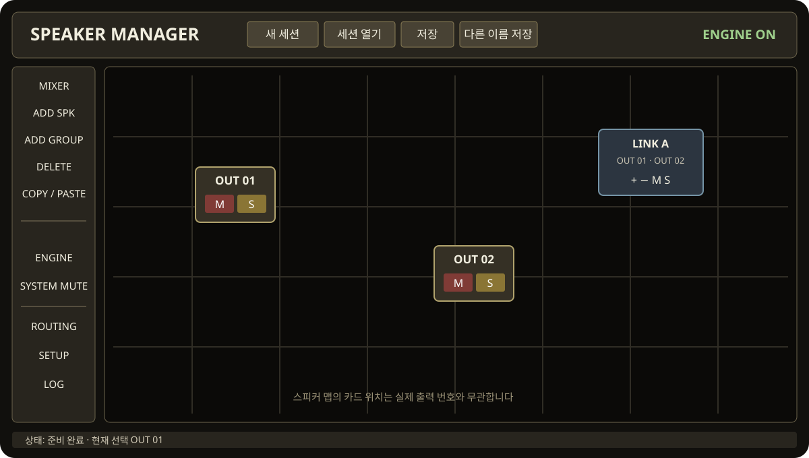

# Dreamscape VSC · Speaker Manager 사용 설명서

**대상:** Windows 11 x64 · 내부 시험판 0.22.0-internal11의 공개 사용 안내 · 48 kHz
**용도:** 한 송출 앱에서 Dreamscape VSC로 보낸 오디오를 Speaker Manager가 받아, 운영자가 선택한 물리 ASIO 인터페이스로 출력

**이 문서의 순서:** 설치 → Speaker Manager 화면과 세션 → 출력·그룹·라우팅·DSP 설정 → 엔진 운용 → REAPER 또는 MadMapper 연결 → 진단·제거. 화면 이름과 조작은 `0.22.0-internal11` 기준입니다. 그림은 조작 위치를 설명하는 구성도입니다.

> **핵심 구분:** REAPER·MadMapper의 **출력 장치**는 `Dreamscape Virtual Sound Card`입니다. Speaker Manager의 **입력 장치**는 `Dreamscape VSC (수신)`이고, **물리 출력 장치**는 Audient·DN32-USB·L-ISA Audio Bridge 같은 실제 출력용 ASIO 드라이버입니다. VSC를 물리 출력으로 고르지 마세요.

VSC는 Windows의 일반 사운드 장치 목록이 아닌 **ASIO 장치**입니다. 송출은 한 앱, 수신은 Speaker Manager 한 인스턴스만 사용합니다. REAPER와 MadMapper를 동시에 VSC 송출자로 사용할 수 없습니다. 앱 실행 순서에는 제약이 없습니다.

## 1. 설치와 준비

1. REAPER, MadMapper, Speaker Manager 등 오디오 앱을 종료합니다.
2. **현재 공개 설치 파일은 제공되지 않습니다.** 내부 시험용 패키지를 받은 운영자는 통합 설치 파일을 실행하고, 설치 구성에서 **Speaker Manager + Dreamscape VSC**를 선택합니다. 기본 선택인 `Speaker Manager만 설치`를 그대로 두면 VSC는 설치되지 않습니다. 관리자 승인이 필요할 수 있습니다.
3. 사용할 **물리 인터페이스의 제조사 ASIO 드라이버**를 별도로 설치하고, 인터페이스를 연결·전원 투입합니다. 해당 드라이버가 48 kHz에서 열리는지도 확인합니다.
4. 설치 후 이미 실행 중이던 오디오 앱은 완전히 종료하고 다시 실행해 ASIO 목록을 새로 읽게 합니다.

VSC 송출 형식은 **48,000 Hz / 256 samples / 64 출력 채널 / 32-bit float**입니다. 호환성 시험용 입력 2채널도 보이지만 항상 **무음**이며 루프백이 아닙니다. 물리 인터페이스의 버퍼 크기는 제조사 드라이버에서 지원하는 값으로 별도로 설정할 수 있습니다. 가상 링크와 물리 인터페이스는 둘 다 48 kHz여도 독립된 클록입니다.

## 2. Speaker Manager에서 물리 출력 설정

1. 물리 출력 레벨을 낮춘 상태에서 Speaker Manager를 열고 **SETUP → AUDIO**로 이동합니다.
2. **ASIO 장치 새로고침**을 누릅니다.
3. **입력 장치**를 `Dreamscape VSC (수신)`으로 선택합니다.
4. **물리 출력 장치**에서 실제 연결된 장치의 ASIO 드라이버를 선택합니다. 예: `Audient iD...`, `DN32-USB ASIO Driver`, `L-ISA Audio Bridge`. 표시 이름은 컴퓨터마다 다릅니다.
5. **입력 채널 수 / 출력 채널 수**를 실제 운용 채널 수에 맞춥니다. 예를 들어 12입력·12출력이 필요하면 둘 다 `12`로 설정하고, 물리 장치가 12출력을 제공하는지 확인합니다. 현재 세션의 채널 구성도 이 수와 맞아야 합니다. 2출력 장치에서 12출력으로 자동 축소되지 않습니다.
6. 원하는 출력 채널로 라우팅한 다음 **실시간 시작**을 누릅니다. 송출 앱이 아직 없다면 `송신 앱 대기`로 시작합니다. 송출이 연결되면 `버퍼 준비 중`을 거쳐 `준비 완료`가 됩니다.

**DN32-USB 예:** 콘솔 전원·USB 연결·제조사 ASIO 드라이버가 모두 준비되어야 합니다. Windows에 드라이버 이름이 등록되어 있다는 사실만으로 실제 장치가 열리는 것은 아닙니다.
**L-ISA Audio Bridge 예:** 이를 물리 출력으로 선택했다면 L-ISA Processor의 오디오 엔진도 실행 중이어야 합니다. 이는 L-ISA 출력 장치의 조건이며 VSC의 앱 실행 순서와는 무관합니다.

## 3. Speaker Manager 화면 익히기

앱은 **스피커 맵**을 기본 화면으로 엽니다. 상단에는 `새 세션`, `세션 열기`, `저장`, `다른 이름 저장`, 엔진 상태와 CPU 표시가 있습니다. 왼쪽 툴 섹션에는 `MIXER`, `ADD SPK`, `ADD GROUP`, `DELETE`, `COPY`, `PASTE`, `ENGINE`, `SYSTEM MUTE`, `ROUTING`, `SETUP`, `LOG`가 있습니다. 창 아래의 상태 문구는 마지막 조작과 오류를 알려줍니다.

맵의 `OUT 01` 같은 카드는 **물리 출력 번호**를 나타냅니다. 카드를 움직여도 출력 번호나 오디오 라우팅은 바뀌지 않습니다. 카드를 한 번 클릭하면 선택, 두 번 클릭하면 출력 편집기가 열립니다. 빈 배경을 클릭하면 편집기를 닫습니다. 카드의 `M`은 해당 출력 MUTE, `S`는 SOLO입니다. 여러 출력을 SOLO할 수 있지만 SOLO는 채널 MUTE·그룹 MUTE·SYSTEM MUTE·fault mute를 풀지 않습니다.

**현재 버전에서 OUTPUT CHECK는 툴 섹션에 없습니다.** 기능 검증 후 다시 제공할 예정이므로 이 매뉴얼은 출력 체크 버튼을 전제로 하지 않습니다.

## 4. 세션 만들기·저장·불러오기

1. 상단 **새 세션**을 누르면 기본 구성이 만들어지고 `SYSTEM MUTE`가 적용됩니다. 변경 중인 세션이 있으면 버릴지 확인합니다.
2. 출력·그룹·라우팅·DSP·맵 위치를 구성한 뒤 **다른 이름 저장**을 눌러 `.smsession` 파일을 만듭니다. 파일 이름이 화면의 세션 이름이 됩니다.
3. 기존 파일을 편집했다면 **저장**은 같은 파일을 갱신합니다. 처음 저장하거나 별도 사본이 필요하면 **다른 이름 저장**을 사용합니다. `Ctrl+S`와 `Ctrl+Shift+S`도 사용할 수 있습니다.
4. **세션 열기**는 저장된 `.smsession`을 읽습니다. **엔진이 정지된 상태에서만** 새 세션 생성·불러오기가 가능합니다. 읽기 실패 시 이전 저장본 `.bak`을 여는 복구 안내가 나올 수 있습니다. 복구 후에는 새 파일로 저장합니다.

세션에는 채널 처리, 라우팅, 그룹, 맵 배치·평면도가 들어갑니다. 장치 이름은 연결 참고 정보로 저장되지만, 세션을 열어도 **실제 ASIO 장치를 자동 변경하지 않습니다.** 세션을 열 때는 저장 당시 상태와 관계없이 `SYSTEM MUTE`가 적용됩니다. 라이브 운용 중 저장은 엔진 적용 확인이 끝난 설정만 허용됩니다. `SETUP`의 **설정 JSON 가져오기/내보내기**는 세션 파일과 다른 고급 설정 교환 기능입니다.

## 5. 출력과 스피커 맵 구성

1. **SETUP → AUDIO**의 `입력 채널 수`와 `출력 채널 수`를 운용 구성에 맞춥니다. 출력 채널 수는 세션의 활성 출력 수에도 반영됩니다. **채널 수 변경은 엔진 정지 후** 수행합니다. 물리 인터페이스가 실제 제공하지 않는 출력 번호는 선택하지 않습니다.
2. `ADD SPK`는 가장 낮은 빈 출력 번호에 카드를 만듭니다. 같은 번호의 입력이 존재하면 그 입력에서 새 출력으로 기본 라우트를 연결합니다. 새 출력은 기본적으로 채널 MUTE가 해제될 수 있으므로, 엔진을 켜기 전에 `M`과 라우팅을 확인합니다.
3. 카드를 우클릭하면 출력 이름과 색을 바꿀 수 있습니다. 카드를 드래그해 배치하고, **Ctrl+카드 경계 드래그**로 크기를 바꿉니다. Shift+클릭 또는 빈 맵에서 Shift+드래그로 여러 카드를 선택하고 Shift+드래그로 함께 이동할 수 있습니다. 배치는 12 px 격자에 맞춰집니다.
4. **SETUP → MAP**에서 PNG 평면도를 불러오거나 제거하고 배율을 조정합니다. PNG는 2 MiB 이하, 가로·세로 각각 4096 px 이하입니다. `배치 초기화`는 출력 위치를 초기화하며 평면도는 유지합니다. 맵 변경 후 세션을 저장합니다.
5. 선택한 출력에 `DELETE`를 누르면 해당 **물리 번호를 남긴 채** 빈 슬롯으로 만들고 라우트를 끕니다. 활성 출력 삭제는 엔진 정지 중에만 가능합니다.

## 6. 그룹과 라우팅

`ADD GROUP`은 LINK A–L 중 빈 그룹을 만듭니다(최대 12개). 그룹 카드의 `+`를 누르고 포함할 출력 카드를 클릭한 다음 `+`를 다시 누르거나 빈 배경을 눌러 확정합니다. `−`는 구성원 해제 모드입니다. 그룹 카드를 더블클릭하면 그룹 전용 gain·delay·MUTE·EQ 12슬롯을 편집합니다. **유효 gain과 delay는 출력 값에 그룹 값을 더하며, 그룹 EQ는 출력 EQ 뒤에 별도로 적용**됩니다. 그룹을 삭제해도 각 출력의 원래 gain·delay·EQ 설정은 남습니다. 그룹의 `M`과 `S`는 각각 구성원 MUTE와 구성원 SOLO입니다.

툴 섹션의 **ROUTING**을 누르면 가로 `IN 01…`, 세로 `OUT 01…` 행렬이 열립니다. 체크된 교차점만 연결됩니다. 예를 들어 `IN 03 → OUT 07`을 켜면 송출 앱의 VSC 출력 03이 Speaker Manager 입력 03을 거쳐 물리 출력 07로 갑니다. 여러 입력을 한 출력에 연결하면 0 dB 계수로 합산하며 **자동 감쇠·정규화는 하지 않습니다.** 다른 출력으로 분기하려면 필요한 교차점을 각각 켭니다. 맵 카드 위치는 이 행렬에 영향을 주지 않습니다.

## 7. 출력 처리: 레벨·딜레이·EQ

출력 카드를 **더블클릭**해 편집기를 엽니다. `GAIN · DELAY`에서 출력 gain, `POLARITY` 극성 반전, 출력 `MUTE`, delay 값과 `ENABLE`을 설정합니다. Delay를 꺼도 입력한 값은 세션에 남고 처리에서만 빠집니다. 딜레이의 유효 합계(출력+그룹)는 0–100 ms 범위여야 합니다. 게인 숫자 입력에서는 양수에 `+`를 붙입니다. 예를 들어 `+10`은 +10 dB, `10`은 −10 dB로 해석됩니다.

`EQ · FILTER`에는 출력별 EQ 01–12, 별도 `HIGH-PASS`·`LOW-PASS`와 `AP 01`·`AP 02`가 있습니다. EQ 슬롯의 유형은 Bell, Notch, LShelf, HShelf 중 선택합니다. 필터 헤더를 눌러 켜고 끄며, 주파수·gain·Q와 크로스오버 기울기·유형을 설정합니다. 그래프 점은 드래그·휠로 조정하고, OFF 점을 더블클릭하면 켤 수 있습니다. `PHASE`는 **전기적 필터 위상 표시**이며 출력 delay·극성·공간 음향 경로를 반영한 실측 결과가 아닙니다.

상단 **EQ BYPASS**는 선택 출력의 EQ 01–12 값을 보존한 채 우회합니다. **선택 EQ 초기화**는 선택 슬롯, **전체 EQ 초기화**는 해당 출력의 EQ 01–12를 기본값으로 돌립니다. 두 기능 모두 HP/LP·AP·그룹 EQ에는 영향을 주지 않습니다. 그룹 편집기에는 자체 EQ 12슬롯이 있지만 HP/LP/AP는 없습니다.

`MIXER`에서는 출력별 gain과 MUTE를 한 번에 조작합니다. `IN` 미터는 **DSP 이전의 ASIO 입력 샘플 피크(dBFS)**로, 스피커 음압이나 인터페이스의 아날로그 출력 레벨이 아닙니다. 맵 카드의 신호 표시도 디지털 출력 버퍼의 상태이며 물리 단자와 앰프를 별도로 확인해야 합니다. `COPY`/`PASTE` 또는 `Ctrl+C`/`Ctrl+V`로 선택한 출력의 처리 설정을 다른 출력에 복사할 수 있습니다. 그룹 처리 복사는 그룹끼리만 붙여넣습니다. 복사 후에는 대상 출력의 채널 번호·라우팅을 별도로 확인합니다.

## 8. 실시간 운용 순서

1. 세션을 열고, Speaker Manager **SETUP → AUDIO**에서 VSC 수신 입력과 실제 물리 출력 ASIO 장치를 다시 확인합니다. 채널 수·ROUTING·출력 MUTE·그룹 MUTE·SOLO도 확인합니다.
2. 송출 앱에서 VSC를 ASIO 출력으로 선택합니다. 앱 실행 순서는 어느 쪽이 먼저여도 됩니다.
3. 툴 섹션 **ENGINE** 또는 `SETUP → AUDIO → 실시간 시작`으로 엔진을 시작합니다. `송신 앱 대기` → `버퍼 준비 중` → `준비 완료`와 상단 `ENGINE ON` 상태를 확인합니다.
4. 실제 재생과 원하는 입력 채널의 `IN` 미터를 확인합니다. SYSTEM MUTE가 켜져 있으면 운용자가 이를 해제해야 물리 출력 게이트가 열립니다. 개별 출력·그룹 MUTE나 fault mute가 남아 있으면 별도로 원인을 확인합니다.
5. 운용 중 설정 변경은 상태 표시가 **엔진 적용을 확인한 뒤** 저장합니다. 종료할 때는 `SYSTEM MUTE`를 적용하고 **ENGINE OFF** 또는 `정지/음소거`로 엔진을 정지합니다. 새 세션 불러오기·채널 수 변경·출력 삭제는 정지 후 진행합니다.

`SYSTEM MUTE`는 전체 출력 게이트이며 각 출력의 MUTE 설정과 별개입니다. 일반 사용자 MUTE 해제로 fault 상태가 지워지지 않습니다. 앱은 다른 물리 장치로 자동 전환하거나 출력 수를 자동 축소하지 않습니다. 기본 라이브 경로에 고정 HP·limiter·출력 감쇠가 자동으로 들어간다고 가정하지 마세요.

## 9. REAPER → VSC → Speaker Manager

1. REAPER에서 **Options → Preferences → Audio → Device**를 엽니다.
2. **Audio system**을 `ASIO`, **ASIO Driver**를 `Dreamscape Virtual Sound Card`로 설정합니다.
3. **Request sample rate**를 체크하고 `48000`, **Request block size**를 체크하고 `256`을 입력합니다.
4. **Output range**를 `1: SM Send 01`부터 필요한 마지막 채널까지 선택합니다. 64채널 전체를 쓰려면 `64: SM Send 64`까지 지정합니다. **Enable inputs**는 녹음이 필요하지 않다면 해제해도 됩니다. VSC의 입력 2채널은 무음입니다.
5. **OK**를 누른 뒤, REAPER의 장치 상태가 열린 상태인지 확인합니다. 트랙의 **ROUTE** 또는 **Routing Matrix**에서 각 트랙을 원하는 VSC 출력 채널로 보냅니다. 마스터 스테레오만 연결하면 기본적으로 1·2채널만 전송됩니다.
6. Speaker Manager에서 동일한 번호의 입력 채널을 원하는 물리 출력 채널로 라우팅하고 재생·미터를 확인합니다.

예: REAPER 트랙을 `SM Send 03`으로 송출하면 Speaker Manager 입력 03으로 들어옵니다. 입력 03을 물리 출력 07로 라우팅한 경우 실제 인터페이스의 출력 07로 갑니다. 채널 번호를 자동으로 합치거나 변경하지 않습니다.

REAPER의 장치 설정과 트랙 라우팅은 [REAPER 공식 사용자 안내서](https://dlx.reaper.fm/userguide/)도 참고하세요.

## 10. MadMapper → VSC → Speaker Manager

1. MadMapper의 **Preferences → Audio**에서 **Driver Type**을 `ASIO`로 바꾸고 **OK**를 누릅니다.
2. MadMapper를 **완전히 종료한 뒤 다시 실행**합니다. 드라이버 종류를 바꾼 직후에는 장치 목록이 갱신되지 않을 수 있습니다.
3. **Audio Output** 또는 버전에 따라 **Audio Device**에서 `Dreamscape Virtual Sound Card`를 선택합니다. 샘플레이트는 `48000`, 버퍼는 `256 samples`로 설정합니다.
4. 오디오가 포함된 미디어의 출력 채널을 설정하고 실제 재생을 시작합니다. 분석용 **Audio Input**이 따로 있다면 VSC를 입력으로 선택하지 않습니다. VSC의 입력 2채널은 항상 무음입니다.
5. Speaker Manager에서 수신 상태와 해당 채널 미터, 물리 출력 라우팅을 확인합니다.

MadMapper의 Windows 멀티채널 ASIO 설정과 드라이버 변경 후 재시작은 [MadMapper 공식 FAQ](https://madmapper.com/madmapper/faq)에 설명되어 있습니다. **internal11의 MadMapper 현장 PC 연결·재생은 아직 검증되지 않았습니다.** 목록에 VSC가 나타나거나 장치가 열린다는 것만으로 재생 성공을 뜻하지 않습니다.

## 11. 출력 확인과 문제 해결

재생 시 **송출 앱의 출력 채널 → Speaker Manager 입력 미터 → 라우팅 대상 출력 미터 → 물리 인터페이스 출력** 순서로 확인합니다. 미터가 움직여도 물리 장치가 열리지 않았거나 외부 인터페이스의 라우팅이 다르면 소리는 나오지 않습니다. 처음에는 시험 신호와 낮은 레벨로 각 채널을 개별 확인하세요.

- **VSC가 송출 앱에 안 보임:** ASIO 모드를 선택했는지, 통합 설치에서 VSC 옵션을 골랐는지 확인합니다. 앱을 완전히 종료·재실행합니다. MadMapper는 Driver Type을 ASIO로 저장한 뒤 다시 실행해야 합니다.
- **REAPER는 보이는데 MadMapper에서 안 보임:** MadMapper의 ASIO 선택·재시작 뒤에도 없으면 해당 PC의 MadMapper 로그와 Speaker Manager의 **ASIO 진단 복사** 내용을 수집합니다. 목록 누락 원인을 재설치만으로 단정할 수 없습니다.
- **물리 장치가 목록에 없거나 열기 실패:** 제조사 드라이버, USB 연결, 전원, 48 kHz 설정을 확인합니다. Speaker Manager의 **ASIO 장치 새로고침** 및 **ASIO 진단 복사**로 `등록됨`과 `엔진에서 초기화됨`을 구분합니다. DN32-USB는 콘솔 연결 없이 초기화되지 않을 수 있습니다. L-ISA Audio Bridge라면 Processor 엔진도 확인합니다.
- **`fault mute` / `fault 12`:** 진단 로그의 수신 누락·서비스·물리 출력 상태를 확인합니다. 원인이 해결되기 전 일반 사용자 MUTE 해제로 fault가 지워지지 않습니다. 연결과 출력 장치를 복구한 뒤 엔진을 다시 시작하거나 앱의 fault recovery 절차를 사용합니다.
- **소리가 1·2채널에만 있음:** REAPER 마스터 스테레오만 송출 중인지, MadMapper 미디어 출력 채널과 Speaker Manager 라우팅이 일치하는지 확인합니다.

## 12. 로그·원격 제어·제거

툴 섹션의 **LOG**에서 최근 조작과 엔진 오류를 확인합니다. 링크나 물리 ASIO 오류가 발생하면 상태 문구의 `진단 로그` 경로와 `SETUP → AUDIO → ASIO 진단 복사` 결과를 함께 보관합니다. 화면의 CPU 수치는 앱과 오디오 자식 프로세스의 사용량 표시이며 실시간 지연·클록 안정성의 단독 합격 기준이 아닙니다.

선택 기능인 **SETUP → NETWORK**에서 웹 제어 서버 주소·포트·허용 범위를 설정하고 `웹 제어 시작`을 누를 수 있습니다. 웹 화면은 같은 세션의 맵·그룹·라우팅·설정 상태를 다룹니다. 엔진 시작·정지와 ASIO 장치 선택은 서버 PC의 데스크톱 앱에서 수행합니다. 네트워크를 사용하지 않으면 웹 제어를 켤 필요가 없습니다.

### 제거와 내부 시험 범위

일반 제거는 **Windows 설정 → 설치된 앱 → Dreamscape Speaker Manager → 제거**를 사용합니다. 내부 시험 패키지로 설치한 뒤 앱을 제거해도 REAPER의 ASIO 목록에 VSC가 남으면, 해당 내부 패키지의 `Dreamscape-VSC-Cleanup-internal11.zip`에 있는 README와 관리자용 제거 스크립트를 사용합니다. 제거 전 ASIO 사용 앱을 닫습니다.

이 패키지는 **비공개 내부 시험판**입니다. 오프라인 검사와 앱 목록 표시만으로 실제 스피커 출력, 지연, 보호 동작 또는 64채널 실물 장치 검증이 완료된 것은 아닙니다. 물리 출력 검증은 해당 시험 환경에서 별도로 수행합니다.
